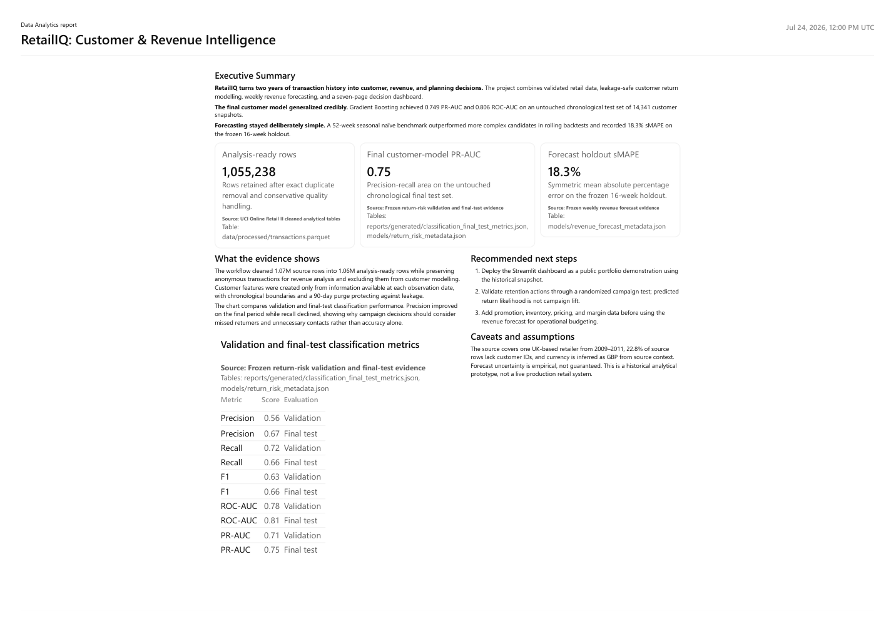

# RetailIQ

[](https://github.com/neilss170/retailiq-customer-analytics/actions/workflows/quality.yml)

RetailIQ is an end-to-end retail analytics project built from the
[UCI Online Retail II dataset](https://archive.ics.uci.edu/dataset/502/online+retail+ii).
It started with a practical question: how much useful customer and revenue
information can be recovered from an imperfect transaction export?

The project combines data-quality checks, customer analysis, leakage-aware
classification, weekly revenue forecasting and a Streamlit dashboard. The
dashboard is designed for a business reader, while the notebooks preserve the
technical reasoning and validation trail.



## What the project covers

- Cleaning and reconciliation of 1,067,371 source rows
- Revenue, product, country and cancellation analysis
- Monthly cohort retention and RFM customer segmentation
- Point-in-time customer features for 90-day return prediction
- Chronological train, validation and test periods with boundary purging
- Logistic Regression, Naive Bayes, Decision Tree, Random Forest, Gradient
  Boosting and XGBoost comparisons
- Five-fold temporal cross-validation, tuning, threshold analysis, SMOTE and
  SHAP
- Weekly revenue forecasting with naive baselines, Exponential Smoothing,
  SARIMA, Gradient Boosting and XGBoost
- Rolling forecast backtesting and a frozen 16-week holdout
- A seven-page Streamlit dashboard and a one-page project report

## Results

### Customer return model

Gradient Boosting was selected using validation PR-AUC. The model and campaign
cutoff were then applied once to the untouched chronological test period.

| Metric | Validation | Final test |
|---|---:|---:|
| Precision | 0.563 | 0.670 |
| Recall | 0.725 | 0.659 |
| F1 | 0.634 | 0.664 |
| ROC-AUC | 0.784 | 0.806 |
| PR-AUC | 0.715 | 0.749 |

The final test improved on ranking and precision but lost 6.6 percentage points
of recall. That trade-off is shown explicitly in the dashboard instead of being
hidden behind accuracy.

### Weekly revenue forecast

The 52-week seasonal naive baseline produced the best average MAE across eight
rolling backtest folds. On the separate 16-week holdout it recorded:

- MAE: £47,055
- RMSE: £65,722
- sMAPE: 18.3%

The simple seasonal model beating the more complex candidates is part of the
result, not a reason to replace it with a more impressive-looking algorithm.

## Dashboard

The dashboard is organized around seven questions:

1. How is the business performing?
2. What contributed to the result?
3. Who generates value?
4. Are customers returning, and who may need attention?
5. What revenue should we expect next?
6. Which records support the current view?
7. How much should we trust the numbers?

It includes period comparisons, product and customer drill-downs, cohort
retention, a historical campaign-capacity simulator, forecast scenarios, model
evidence and clear definitions. Model results use fixed evaluation periods and
do not change when business filters are adjusted.

## Run locally

Python 3.11 is recommended.

```powershell
git clone https://github.com/neilss170/retailiq-customer-analytics.git
cd retailiq-customer-analytics
py -3.11 -m venv .venv
.\.venv\Scripts\python.exe -m pip install -r requirements.txt
.\.venv\Scripts\python.exe -m streamlit run dashboard\app.py
```

The repository includes only the compact historical files required by the
dashboard. The raw workbook, full SQLite database, intermediate feature tables
and saved binary pipelines are excluded.

## Reproduce the analysis

One command rebuilds every table, model, metric and executed notebook from the
raw UCI workbook:

```powershell
.\.venv\Scripts\python.exe scripts\reproduce.py
```

It downloads the workbook to `data/raw/source/` if it is not already there,
checks its SHA-256 against the file the published results came from, then runs
the pipeline in dependency order. The notebooks read tables written by the
command-line steps, so they cannot be run on their own from a fresh clone:

1. `src.cleaning`, `src.analytics`, `src.return_risk_features` and
   `src.return_risk_modeling` (hyperparameter search) write the processed
   tables and search evidence.
2. Notebooks `01`–`07` run in order and are saved in place. Notebook 05
   selects the model, notebook 06 scores the sealed test period once and
   notebook 07 runs the forecast backtest and holdout.

The full run takes about 11 minutes on a laptop, most of it the search. A run
from a clean clone reproduces the committed processed data, predictions and
metrics exactly.

## Project structure

```text
dashboard/      Streamlit application
docs/           Data dictionary
notebooks/      Executed analysis and modelling notebooks
reports/        Figures, one-page report and final report assets
scripts/        Notebook builders and independent reconciliation checks
sql/            Business KPI queries
src/            Reusable cleaning, analytics, modelling and forecasting code
tests/          Unit and boundary tests
```

## Verification

```powershell
.\.venv\Scripts\python.exe -m compileall -q src dashboard tests
.\.venv\Scripts\python.exe -m pytest -q
```

The tests include a headless run of all seven dashboard pages, with and
without narrow filters. GitHub Actions runs the same compilation and test
checks on pushes and pull requests.

## Deploy

The dashboard deploys to Streamlit Community Cloud with `dashboard/app.py` as
the entry point. `dashboard/requirements.txt` holds only its runtime
dependencies, which Community Cloud reads ahead of the root file, and
`.streamlit/config.toml` sets the dark theme.

## Limitations

- The data represents one UK-based retailer from 2009–2011.
- Currency is treated as GBP based on source context; the workbook has no
  currency field.
- Customer IDs are missing on 22.8% of source rows. Anonymous purchases remain
  in revenue analysis but are excluded from customer modelling.
- A predicted future purchase is not evidence that a marketing campaign caused
  the purchase.
- Return-model recall is weak for customers inactive for more than 181 days.
- Forecasting uses 104 complete weeks and has no promotion, inventory, margin,
  marketing or macroeconomic inputs.
- Forecast ranges are empirical planning ranges, not guarantees.

The project is a historical analytical prototype. It is not presented as a
live production retail system.
